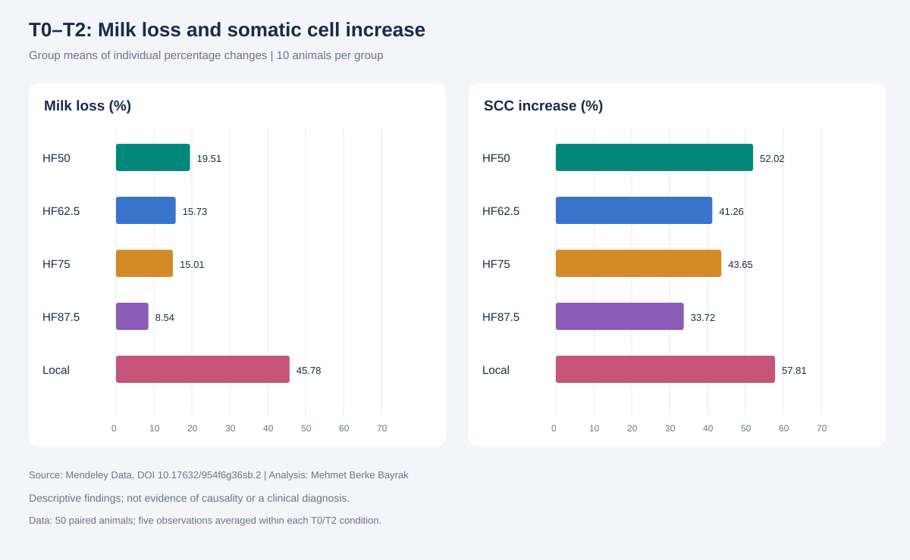
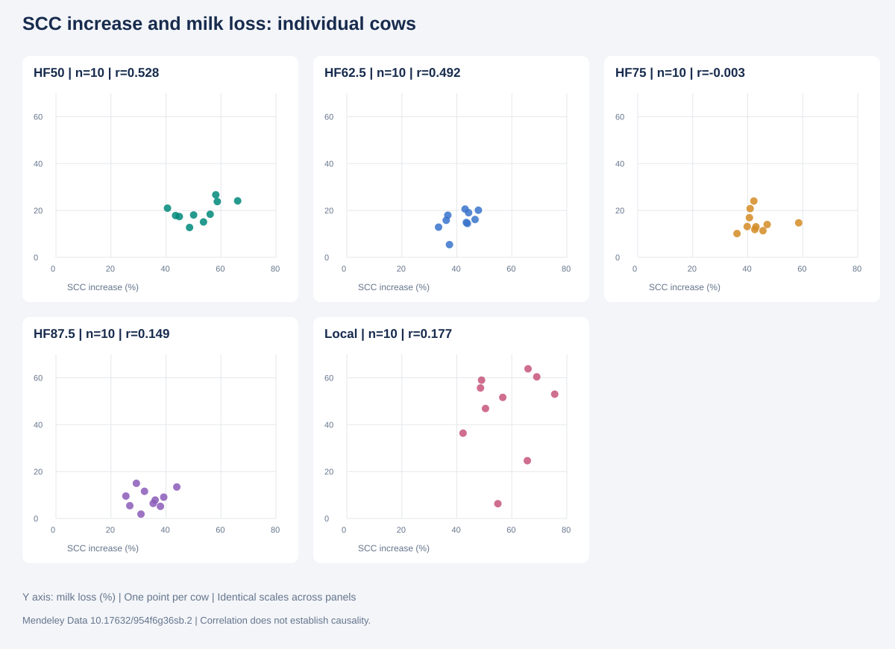

# Milk Yield and Quality under THI Conditions

**Mehmet Berke Bayrak · Industrial Engineer**  
Python · PostgreSQL / SQL · Power BI

[**Türkçe**](README_TR.md) | [Methods & findings](docs/FINDINGS_EN.md) | [Reproduce](docs/REPRODUCE_EN.md) | [Data source](docs/DATA_SOURCE.md)

An independent, descriptive portfolio study of how milk yield, fat, protein and somatic cell count vary across recorded genetic groups and THI categories. This is not a commissioned farm study or a clinical assessment.

## Data and research questions

750 observations: 50 cows × 3 THI categories × 5 repeated observations. Recorded groups: Local, HF50, HF62.5, HF75, HF87.5. Each group contains 10 cows. The experimental unit is the cow; repeated observations are not treated as independent animals.

1. How do milk yield, fat/protein percentages and somatic cell count vary across groups and T0/T1/T2?
2. Does the T1 increase in fat percentage offset the decrease in milk volume?
3. How variable are T0–T2 changes between individual cows?
4. Within each genetic group, is greater SCC increase associated with greater milk loss?

## Workflow

1. Inspect workbook headers and validate identifiers, missing values and repeat counts.
2. Average five observations within each animal × THI category.
3. Average animals equally within each group × condition.
4. Match each animal's T0 and T2 values and calculate individual percentage changes.
5. Compute within-group descriptive Pearson correlations; inspect scatter plots and review animal 104 against source records.
6. Prepare Power BI inputs and document report scope.

The included Python pipeline was run and reconciled with the user's supplied PostgreSQL outputs. The SQL files were assembled for reproduction; they were not executed against a database in the delivery environment.

## Main findings

| Group | Mean individual milk loss, T0–T2 (%) | Mean individual SCC increase (%) | Pearson r, n=10 |
|---|---:|---:|---:|
| HF50 | 19.51 | 52.02 | 0.528 |
| HF62.5 | 15.73 | 41.26 | 0.492 |
| HF75 | 15.01 | 43.65 | -0.003 |
| HF87.5 | 8.54 | 33.72 | 0.149 |
| Local | 45.78 | 57.81 | 0.177 |

- All 50 cows had lower mean milk yield and higher mean SCC at T2 than at T0.
- The Local group had the greatest mean individual percentage milk loss and variability. HF87.5 had the smallest mean individual loss in this sample.
- HF87.5 nevertheless had the highest absolute mean SCC at both T0 and T2. Relative change does not establish overall milk-quality superiority.
- Fat percentage rose at T1, but the volume–fat proxy declined in every group.
- Pearson correlation differed descriptively across groups; this does not establish that the correlations are statistically different.





These are reproducible static figures generated from the workbook, not screenshots of a tested final Power BI report.

## Power BI delivery status

The `powerbi/` folder includes the original user report and a three-page **design draft** with the same embedded animal-change model. ZIP/JSON integrity, block geometry and model identity were checked. **Power BI Desktop opening, rendering and filter interactions were not tested** because desktop access was unavailable. It must be reviewed in Desktop before being presented as a finished dashboard.

The broader milk-composition pages are **not yet implemented inside PBIX**. Ready-to-import group summaries, composition proxies and a bilingual report guide are included. See [report guide](powerbi/REPORT_GUIDE_TR_EN.md).

## Repository structure

```text
├── README.md / README_TR.md
├── data/
│   ├── raw/              # attributed source workbook
│   └── processed/        # reproducible Power BI / PostgreSQL CSVs
├── sql/                  # schema, views, quality checks, analysis
├── scripts/analyze.py    # rebuild tables, validation and SVG figures
├── powerbi/              # original PBIX, design draft, report guide
├── images/               # Turkish / English figures
├── docs/                 # methods, findings, dictionary, source, setup
└── reports/              # validation evidence and delivery checklist
```

## Reproduce

See [English instructions](docs/REPRODUCE_EN.md) or [Türkçe yönergeler](docs/YENIDEN_CALISTIRMA_TR.md). Run `scripts/analyze.py` from any working directory after installing `requirements.txt`. It locates inputs relative to its own path.

## Interpretation boundaries

This analysis is descriptive and exploratory: no hypothesis tests, confidence intervals, causal model or veterinary diagnosis were performed. Recorded HF categories are not verified genetic-purity measurements. T0/T1/T2 are retained as source categories. Volume–composition proxies are not exact fat/protein mass yields and assume equal milk density for relative comparison. Do not pool 750 repeated observations as 750 independent cows.

## Attribution and licence

Research data: Pehan Eshtiak Ahamed (2026), Mendeley Data, V2, DOI [10.17632/954f6g36sb.2](https://doi.org/10.17632/954f6g36sb.2), **CC BY 4.0**. Source workbook copied with a normalized filename; derived tables and figures are adaptations. Local workbook byte identity with the online version was not verified. See [source provenance](docs/DATA_SOURCE.md).

Original project code/documentation: MIT; research data and derived research figures/tables retain CC BY 4.0 attribution. See [LICENSE](LICENSE).

**Status:** reproducible descriptive analysis packaged on 2 November 2026; Power BI design remains pending Desktop review. Repository prepared for publication on GitHub; Desktop validation remains pending.
