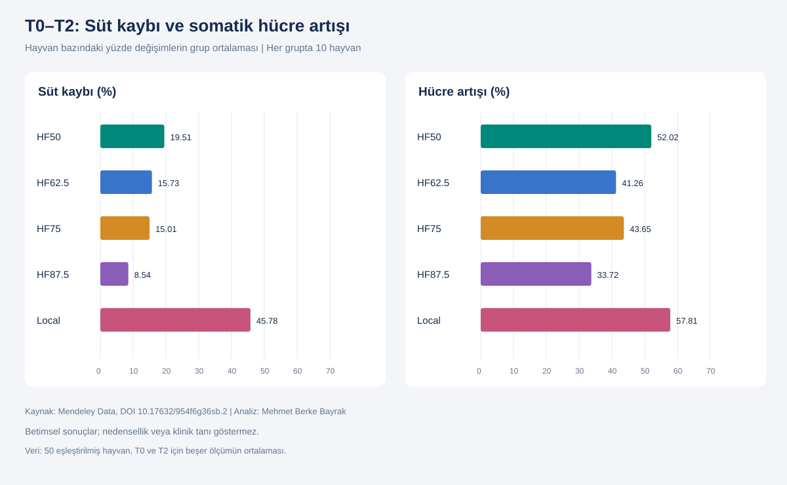
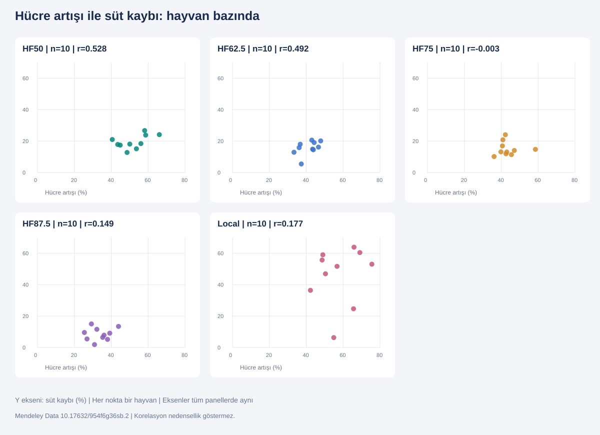

# THI Koşullarında Süt Verimi ve Kalitesi Analizi

**Mehmet Berke Bayrak · Endüstri Mühendisi**  
Python · PostgreSQL / SQL · Power BI

[**English**](README.md) | [Bulgular ve yöntem](docs/BULGULAR_TR.md) | [Yeniden çalıştırma](docs/YENIDEN_CALISTIRMA_TR.md) | [Veri kaynağı](docs/DATA_SOURCE.md)

Genetik gruplar ve sıcaklık-nem (THI) kategorileri boyunca süt miktarı, yağ, protein ve somatik hücre sayısını inceleyen bağımsız, betimsel portföy çalışmasıdır. Bir işletme adına yapılmış müşteri işi veya klinik değerlendirme değildir.

## Veri ve araştırma soruları

**750 gözlem = 50 hayvan × 3 THI kategorisi × 5 tekrar.** Local, HF50, HF62.5, HF75 ve HF87.5 gruplarının her birinde 10 hayvan vardır. Tekrarlı ölçümler ayrı hayvanlar olarak değerlendirilmemiştir.

1. Genetik grup ve T0/T1/T2 boyunca süt, yağ, protein ve hücre sayısı nasıl değişiyor?
2. T1'de yağ yüzdesindeki artış, süt miktarındaki düşüşü karşılıyor mu?
3. Hayvanların bireysel T0–T2 değişimleri ne kadar farklılaşıyor?
4. Aynı genetik grup içinde hücre artışı daha fazla olan hayvanlarda süt kaybı da daha büyük mü?

## Yaptığım işlemler

- Excel başlıklarını, kayıt sayısını, eksikleri ve ölçüm kimliklerini kontrol ettim.
- Her hayvanın aynı THI kategorisindeki beş ölçümünü özetledim.
- Hayvanlara eşit ağırlık vererek 15 grup-koşul ortalaması oluşturdum.
- 50 hayvanın T0 ve T2 değerlerini eşleştirdim; bireysel değişimleri hesapladım.
- Grup içi Pearson korelasyonlarını ve dağılım grafiklerini inceledim.
- Local grubunda ayrışan 104 numaralı hayvanı kaynak kayıtlarından kontrol ettim; hatalı olduğu kanıtlanmadığından korudum.
- Power BI girdilerini, rapor taslağını ve yöntem açıklamalarını düzenledim.

Teslim sırasında Python analizleri kaynak Excel'den yeniden çalıştırıldı ve paylaştığım PostgreSQL çıktılarıyla karşılaştırıldı. SQL dosyaları yeniden çalıştırılabilir şekilde hazırlandı; teslim ortamında veritabanına bağlanılarak çalıştırılmadı.

## Temel bulgular

| Grup | Ortalama bireysel süt kaybı (%) | Ortalama bireysel hücre artışı (%) | Pearson r, n=10 |
|---|---:|---:|---:|
| HF50 | 19,51 | 52,02 | 0,528 |
| HF62.5 | 15,73 | 41,26 | 0,492 |
| HF75 | 15,01 | 43,65 | -0,003 |
| HF87.5 | 8,54 | 33,72 | 0,149 |
| Local | 45,78 | 57,81 | 0,177 |

- 50 hayvanın tamamında T2 süt ortalaması T0'dan düşük, hücre ortalaması daha yüksekti.
- Local grubunda ortalama bireysel süt kaybı ve değişkenlik en yüksek; HF87.5'te ortalama bireysel kayıp en düşüktü.
- Buna rağmen HF87.5'in mutlak ortalama hücre sayısı T0 ve T2'de en yüksekti. Yalnızca yüzde değişimden kalite üstünlüğü çıkarılamaz.
- T1'de yağ yüzdesi artmasına rağmen süt × yağ göstergesi bütün gruplarda düştü.
- Korelasyonların sayısal olarak farklı çıkması, aralarındaki farkın istatistiksel olarak kanıtlandığı anlamına gelmez.





Görseller kaynak Excel'den hesaplanan statik figürlerdir; tamamlanmış bir Power BI raporunun ekran görüntüsü değildir.

## Power BI durumu

`powerbi/` klasöründe orijinal kullanıcı dosyası ve aynı hayvan-değişim modelini koruyan üç sayfalık **tasarım taslağı** vardır. Dosya/JSON bütünlüğü, blok sınırları ve veri modelinin aynı kaldığı kontrol edildi. **Power BI Desktop açılış, görünüm ve etkileşim testi yapılamadı.** Tamamlanmış rapor olarak sunulmadan önce Desktop'ta kontrol edilmelidir.

Yağ/protein genel bakış sayfaları **PBIX içinde henüz uygulanmadı**. Bu sayfalar için CSV girdileri ve [iki dilli rapor planı](powerbi/REPORT_GUIDE_TR_EN.md) hazırlanmıştır.

## Klasör yapısı

```text
├── README.md / README_TR.md
├── data/raw/             Ham kaynak Excel
├── data/processed/       Tekrar üretilebilir analiz ve Power BI CSV'leri
├── sql/                  Şema, görünümler, kontroller ve sorgular
├── scripts/analyze.py    Hesaplama ve doğrulama
├── powerbi/              Orijinal rapor, tasarım taslağı ve rapor rehberi
├── images/               Türkçe ve İngilizce figürler
├── docs/                 Yöntem, bulgular, sözlük, kaynak ve kurulum
└── reports/              Doğrulama ve teslim kontrolü
```

## Kaynak ve sınırlar

Kaynak: Pehan Eshtiak Ahamed (2026), Mendeley Data V2, DOI [10.17632/954f6g36sb.2](https://doi.org/10.17632/954f6g36sb.2), CC BY 4.0. Dosyanın yerel kopyası yeniden adlandırıldı; türetilmiş tablolar ve figürler bu kaynaktan üretildi. Web sürümüyle bayt düzeyinde eşitlik kontrol edilmedi. Ayrıntılar: [kaynak kaydı](docs/DATA_SOURCE.md).

Bu çalışma anlamlılık testi, güven aralığı, nedensellik veya veteriner tanısı içermez. HF etiketleri kayıtlı genetik gruplardır; genetik saflık belgesi değildir. T0/T1/T2 kategorik kullanılmıştır. Süt × yağ/protein göstergeleri kesin kütle üretimi değildir; göreli yorum aynı süt yoğunluğu varsayımına dayanır.

Kod ve özgün proje belgeleri MIT; araştırma verisi ve türetilmiş veri/figürler kaynak CC BY 4.0 atfıyla sunulmuştur. [Lisans](LICENSE).

**Durum:** 2 Kasım 2026'da paketlendi. Betimsel analizler yeniden üretildi; Power BI taslağının Desktop kontrolü bekliyor. GitHub yayını için hazırlanmıştır; Desktop doğrulaması beklemektedir.
